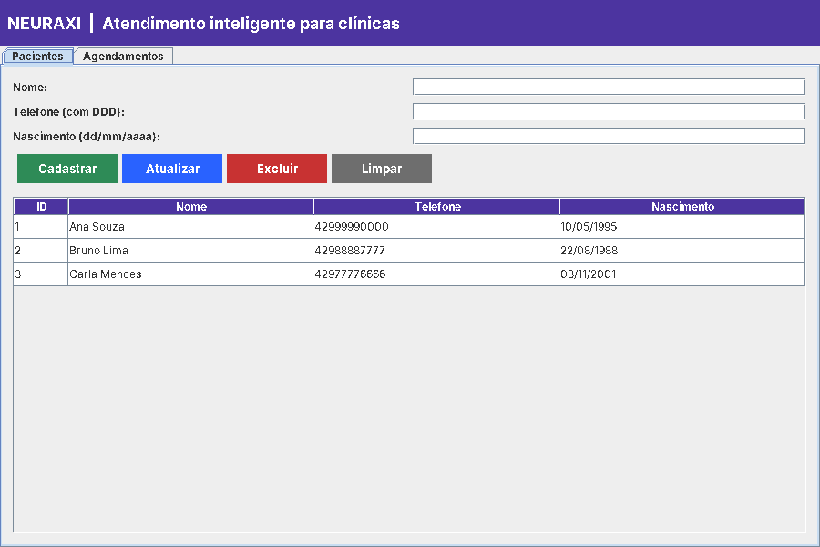
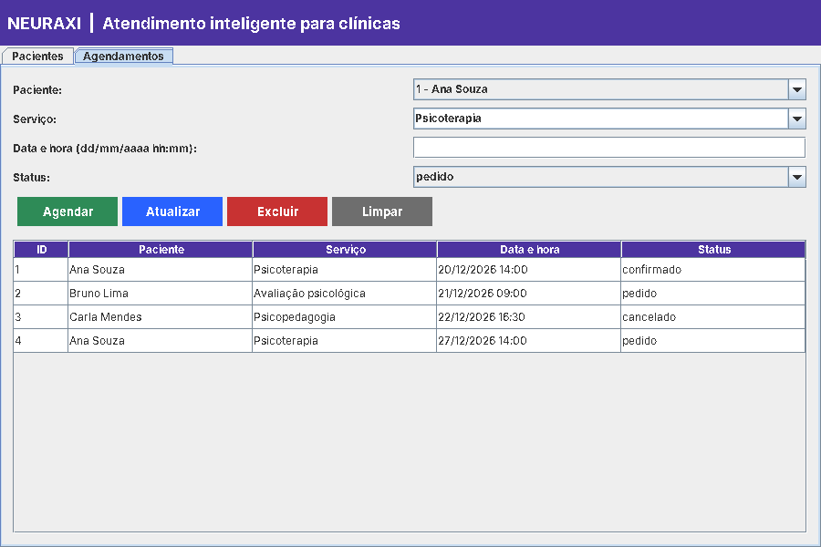

# Neuraxi | Gestão de Pacientes e Agendamentos

Aplicação desktop em Java para clínicas, feita a partir da startup **Neuraxi** (atendimento inteligente por WhatsApp para clínicas). O sistema faz o CRUD completo de **pacientes** e dos **agendamentos** de cada paciente, com persistência em banco relacional SQLite.

Projeto da disciplina de Programação Orientada a Objetos, aplicando **MVC** e **DAO**.

## Screenshots

**Aba Pacientes**



**Aba Agendamentos**



## Integrantes

| Nome completo | R.A. |
|---|---|
| Nicollas Bryan Teixeira | 000000 |
| Nome do integrante 2 | 000000 |
| Nome do integrante 3 | 000000 |

## Tecnologias e bibliotecas

* Java 17 ou superior (testado com Java 21)
* Java Swing (interface gráfica, já vem no JDK)
* SQLite (banco relacional em arquivo)
* JDBC com o driver [sqlite-jdbc 3.47.1.0](https://github.com/xerial/sqlite-jdbc) (pasta `lib`)
* SLF4J 1.7.36 (dependência do driver, pasta `lib`)

## Banco de dados

Duas tabelas relacionadas (1:N): um **paciente** pode ter vários **agendamentos**.

| Tabela | Campos |
|---|---|
| `paciente` | `id_paciente` (PK), `nome`, `telefone`, `data_nascimento` |
| `agendamento` | `id_agendamento` (PK), `id_paciente` (FK), `servico`, `data_hora`, `status` |

* A FK `fk_agendamento_paciente` usa `ON DELETE RESTRICT`: não é possível apagar um paciente que tem agendamentos.
* O `status` tem valor padrão `pedido` e `CHECK` com os valores `pedido`, `confirmado`, `realizado` e `cancelado`.

O script está em [`database/neuraxi.sql`](database/neuraxi.sql). **Não é preciso rodar nada manualmente:** na primeira execução o sistema lê esse script e cria o arquivo `neuraxi.db` sozinho.

## Como instalar e executar

### 1. Instale o Java (JDK 17 ou superior)

No Windows, pelo terminal:
```
winget install EclipseAdoptium.Temurin.21.JDK --source winget
```
Ou baixe em [adoptium.net](https://adoptium.net). Confira com `java -version`.

### 2. Baixe o projeto
```
git clone https://github.com/N1iki1/trabalho-final-poo.git
cd trabalho-final-poo
```

### 3. Execute

**Windows:** dê dois cliques em `executar.bat`.

**Linux ou macOS:**
```
./executar.sh
```

**Manualmente (Windows):**
```
dir /s /b src\*.java > fontes.txt
javac -encoding UTF-8 -d out -cp "lib/*" @fontes.txt
java -cp "out;lib/*" br.com.neuraxi.Main
```

## Como usar

1. Na aba **Pacientes**, preencha nome, telefone e nascimento e clique em **Cadastrar**.
2. Na aba **Agendamentos**, escolha o paciente, o serviço e a data e hora, e clique em **Agendar**.
3. Para alterar, clique na linha da tabela, mude os campos e clique em **Atualizar**.
4. Para apagar, selecione a linha e clique em **Excluir**.

### Regras de negócio

* Todos os campos são obrigatórios.
* Telefone com DDD (10 ou 11 dígitos) e datas válidas no formato `dd/mm/aaaa`.
* Data de nascimento não pode ser no futuro.
* Novo agendamento não pode ser numa data que já passou.
* Todo agendamento novo começa com status `pedido`.
* Paciente com agendamento não pode ser excluído (regra no controller e FK no banco).

## Arquitetura (MVC + DAO)

```
src/br/com/neuraxi/
├── Main.java                     inicia o banco e abre a tela
├── model/                        MODEL: entidades
│   ├── Paciente.java
│   ├── Agendamento.java
│   ├── StatusAgendamento.java
│   └── dao/                      DAO: todo o acesso ao banco
│       ├── ConexaoBD.java
│       ├── PacienteDAO.java
│       └── AgendamentoDAO.java
├── controller/                   CONTROLLER: validações e regras
│   ├── PacienteController.java
│   ├── AgendamentoController.java
│   ├── Validador.java
│   └── RegraNegocioException.java
└── view/                         VIEW: telas Swing
    ├── TelaPrincipal.java
    ├── PacientePanel.java
    ├── AgendamentoPanel.java
    └── Estilo.java
```

* **View** só monta a tela e chama o controller. Não tem nenhum SQL.
* **Controller** valida os dados, aplica as regras de negócio e transforma erros de banco em mensagens para o usuário.
* **Model** guarda as entidades. Os **DAOs** são as únicas classes que abrem conexão e executam SQL (com `PreparedStatement`).

Conceitos de POO usados: encapsulamento (atributos privados com getters e setters), herança (`PacientePanel extends JPanel`, `RegraNegocioException extends Exception`), enum (`StatusAgendamento`), composição (`Agendamento` tem um `Paciente`) e exceções personalizadas.

## Transparência de IA

> **Atenção, grupo:** revisem esta seção para que ela descreva exatamente o que aconteceu antes de entregar.

Usamos o **Claude (Anthropic)** como assistente durante o desenvolvimento:

* **Geração do código base:** a IA gerou a primeira versão das classes de Model, DAO, Controller e View a partir dos requisitos do trabalho e do domínio da nossa startup (pacientes e agendamentos).
* **Estrutura do DAO e da conexão SQLite:** incluindo a criação automática do banco a partir do script `.sql` e o `PRAGMA foreign_keys`.
* **Telas Swing:** layout, cores e tratamento de mensagens de erro.
* **Tratamento de exceções e validações:** classe `Validador` e `RegraNegocioException`.
* **README:** estrutura deste documento.

Feito pelo grupo: definição do problema e do domínio a partir da startup Neuraxi, escolha das tabelas e regras de negócio, testes do sistema, revisão do código, screenshots e o vídeo. *(Ajustem esta lista com o que cada um fez.)*
